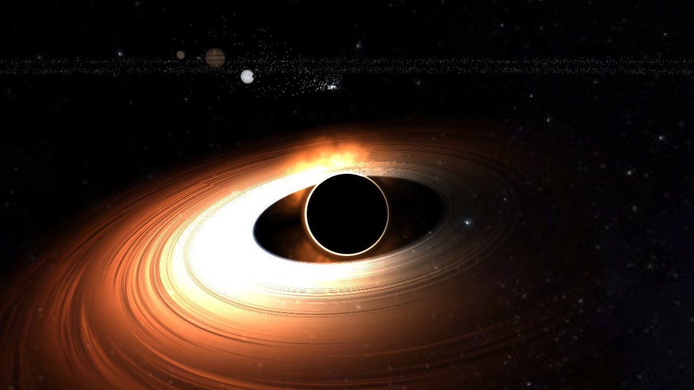
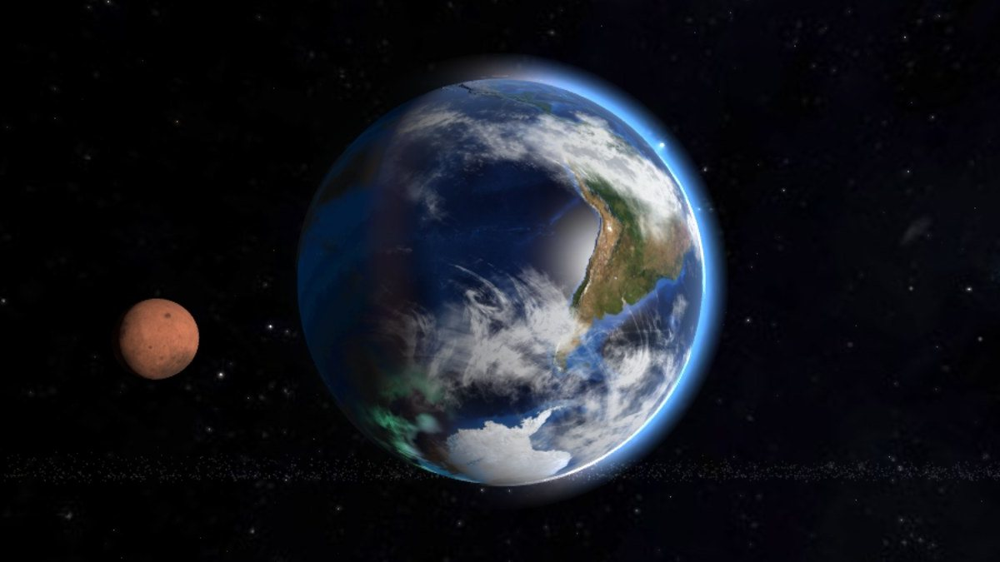
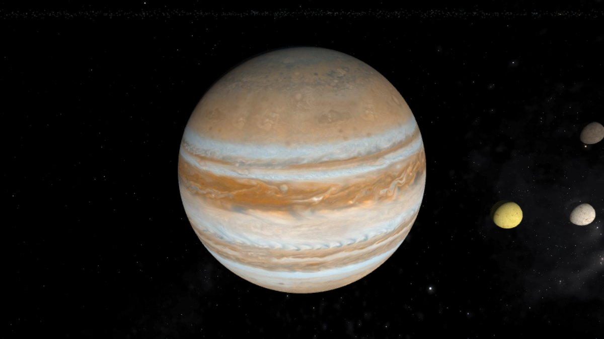
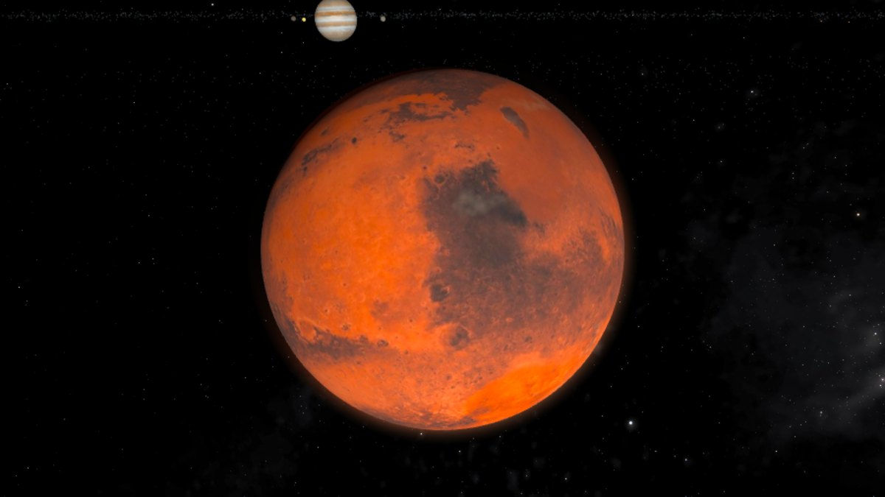
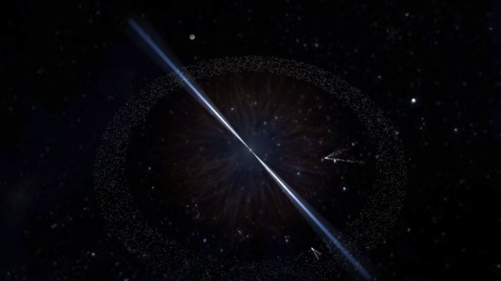
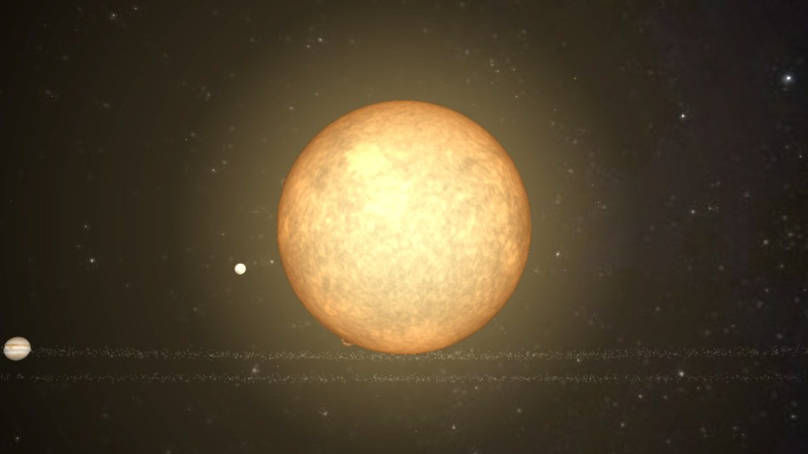
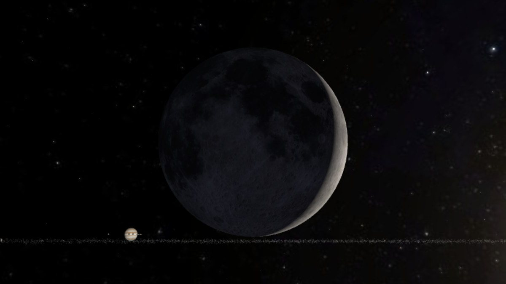
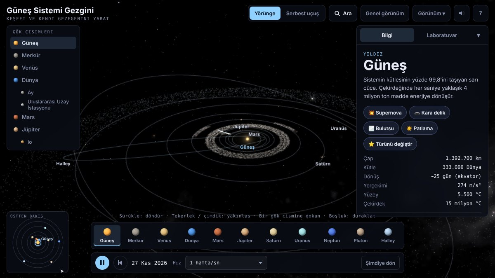

<div align="center">

# 🌌 Celestia

### Tarayıcıda çalışan, gerçek verilerle hesaplanan bir Güneş Sistemi.<br>Keşfet, boz, yeniden kur.

<br>



<sub><i>Güneş'i kara deliğe çevirdik. Diskin bize doğru dönen tarafı Doppler etkisiyle daha parlak; olay ufkunun çevresinde foton halkası.</i></sub>

<br><br>


</div>

---

## ✨ Neden farklı?

Çoğu Güneş Sistemi uygulaması bir animasyondur. **Celestia bir simülasyondur.** Gezegenler bugünkü gerçek yerlerinde durur, tutulmalar gerçek tarihlerinde olur. Laboratuvar modunda fiziği değiştirirsen sonuçlarını da görürsün. Dünya'yı Güneş'e yaklaştırırsan okyanusları kaynar. Mars'ı Dünya'ya fırlatırsan çarpışma enkazı yörüngeye savrulur. Güneş'i kara deliğe çevirirsen gezegenler donar.

<table>
<tr>
<td width="50%"></td>
<td width="50%"></td>
</tr>
<tr>
<td align="center"><b>Dünya:</b> rüzgârla sürüklenen gerçek bulut haritası, gece tarafında şehir ışıkları</td>
<td align="center"><b>Jüpiter:</b> Cassini fotoğraflarından bantlar ve Büyük Kırmızı Leke</td>
</tr>
<tr>
<td></td>
<td></td>
</tr>
<tr>
<td align="center"><b>Mars:</b> Olympus Mons, Valles Marineris, mevsimsel toz fırtınaları</td>
<td align="center"><b>Pulsar:</b> süpernova kalıntısı bulutsu ve deniz feneri gibi dönen ışınlar</td>
</tr>
<tr>
<td></td>
<td></td>
</tr>
<tr>
<td align="center"><b>Güneş:</b> granülasyon, güneş lekeleri, H-alfa filtresi, koronal kütle atımları</td>
<td align="center"><b>Ay:</b> NASA verisinden kraterler ve gerçek evreler</td>
</tr>
</table>

---

## 🔭 Gerçek olan her şey

| | |
|---|---|
| 🪐 **Konumlar** | Gezegenler ve Ay [astronomy-engine](https://github.com/cosinekitty/astronomy) ile hesaplanır. Ekrandaki yerleri bugünkü gerçek yerleridir. |
| 🌑 **Tutulmalar** | Bir sonraki güneş veya ay tutulmasına tek dokunuşla gidilir. Ay'ın gölgesi Dünya'ya düşer, tutulan Ay kızıla döner. |
| 🌍 **Dokular** | NASA görev verilerine dayanan fotoğraflar: Blue Marble, MESSENGER, Magellan radarı, Cassini, Voyager ve LRO. |
| ✴️ **Gökyüzü** | 5.000+ parlak yıldız (Hipparcos / Yale), takımyıldızlar ve doğru yere yerleştirilmiş Samanyolu panoraması. Andromeda ve Macellan Bulutları da gerçek yerlerinde. |
| 🛰️ **Uzay araçları** | ISS, James Webb, Voyager 1, New Horizons ve Parker Solar Probe. |
| ⭐ **Diğer yıldızlar** | Proxima Centauri, Alfa Centauri, TRAPPIST-1 ve yedi gezegeni, 55 Cancri'nin lav dünyası, iki güneşli Kepler-16. |

## 🧪 Laboratuvar: "Ya olsaydı?"

- **İklim modeli.** Yörüngeyi, boyutu ya da atmosferi değiştir; sıcaklık, buzullar, okyanuslar ve yaşanabilirlik puanı canlı olarak güncellenir.
- **Kütleçekim simülasyonu.** Gezegenler birbirini çeker. İki gezegeni çarpıştırabilirsin; Roche sınırını aşan uydular parçalanır.
- **Yıldızın ölümü.** Güneş'i kırmızı deve, beyaz cüceye, süpernovaya ya da kara deliğe dönüştürebilirsin. Kara deliğe fazla yaklaşan gezegen spagetti gibi uzayıp parçalanarak yutulur.
- **Işığı büken kara delik.** Kara deliğe yaklaşınca her piksel için ışığın yolu Schwarzschild uzay-zamanında hesaplanır. Diskin arka tarafı gölgenin üstüne ve altına sarılır, arkadaki gezegenler ve yıldızlar uzaklıklarına göre bükülür, Einstein halkası oluşur.
- **Zamanı geri sar.** Çarpışmaları ve felaketleri geri alabilirsin; ileri oynatınca aynen yeniden yaşanırlar.
- **Kendi gezegenini yarat.** Ekle kataloğundan gezegen, yıldız, nötron yıldızı ya da kara delik seç; yalnızca o cismin ayarları çıkar. Sistemi bir kodla arkadaşına gönderebilirsin.
- **Gelgit kilidi, yüzey görünümü, ölçek yolculuğu.** Bir gezegenin yüzeyinden gökyüzüne bakabilir ya da Güneş'ten en yakın yıldızlara kadar uçabilirsin.

## 🎧 Ekstralar

Bunların hepsi isteğe bağlı:
- NASA ses dönüştürmelerinden esinlenen gezegen sesleri. Pulsar saniyede 10 atımla tıkırdar.
- Gerçek fırtına mevsimlerine göre oluşan kasırgalar.
- Kutup ışıkları.
- Güneş rüzgârı parçacıkları.
- Telefona uygun arayüz.

<div align="center">

</div>

---

## 🚀 Çalıştır

```bash
git clone https://github.com/emirhnnd/Celestia.git
cd Celestia
python3 -m http.server 8000
```

Sonra tarayıcıda **http://localhost:8000** adresini aç. Derleme yok, `npm install` yok; her şey tek bir `index.html` dosyasında.

> Dosyayı doğrudan çift tıklayıp `file://` ile açarsan tarayıcı güvenliği dokuların yüklenmesini engeller. Uygulama yine çalışır, ama kodla üretilen yedek dokulara geçer.

**GitHub Pages ile yayınlamak için:** Settings → Pages → *Deploy from a branch* → `main` / `(root)`. Ek bir iş akışı (workflow) gerekmez.

## 🌿 Dallar

| Dal | İçerik |
|---|---|
| `main` | Gerçek fotoğraf dokuları |
| `eski-modeller` | Kodla üretilen (prosedürel) gezegen dokuları. Daha hafiftir; Dünya dışındaki gezegenlerde gerçek doku kullanmaz. |

## 🧪 Test

`test/` klasöründe, uygulamayı başsız bir tarayıcıda açıp birleşmeleri, çarpışmaları, geri sarmayı, sıfırlamayı, paylaşma kodunu, meteor yağmurunu ve fırtına takibini gerçek zamanlı deneyen senaryolar var. Değişiklikten sonra çalıştır:

```bash
cd test && npm install && npm test
```

Her senaryonun sonucu ve sayfada çıkan hatalar yazdırılır; ekran görüntüleri `test/shots/` klasörüne kaydedilir.

## 🛠️ İçinde neler var

- **three.js r128:** 3D sahne
- **astronomy-engine 2.1.19:** gök mekaniği hesapları
- **Elle yazılmış GLSL gölgelendiriciler:** Güneş granülasyonu, hareketli bulutlar ve kasırgalar, lav, analitik kraterler, halka ve tutulma gölgeleri, ışın izlemeli kara delik (kütleçekimsel mercek, Doppler ve kütleçekimsel kırmızıya kayma)
- **Leapfrog integratörü:** gezegenler arası kütleçekim ve çarpışma fiziği

## 📜 Kaynaklar ve lisanslar

- Gezegen, Güneş, Ay, halka, bulut ve Samanyolu dokuları: [Solar System Scope](https://www.solarsystemscope.com/textures/), CC BY 4.0 (NASA verilerine dayanır)
- Dünya gündüz ve gece dokuları: NASA Blue Marble ve Black Marble
- Yıldızlar ve takımyıldızlar: [d3-celestial](https://github.com/ofrohn/d3-celestial) © Olaf Frohn, BSD (Hipparcos / Yale Parlak Yıldız Kataloğu)
- Kıyı çizgileri: Natural Earth (kamu malı)

<div align="center">
<br>
<sub>Merakla yapıldı. Bir yıldız bırakmayı unutma ⭐</sub>
</div>
