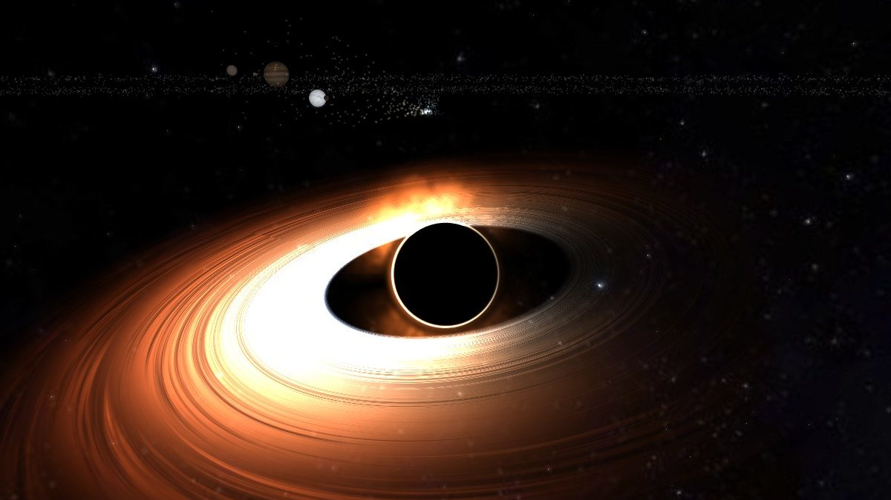
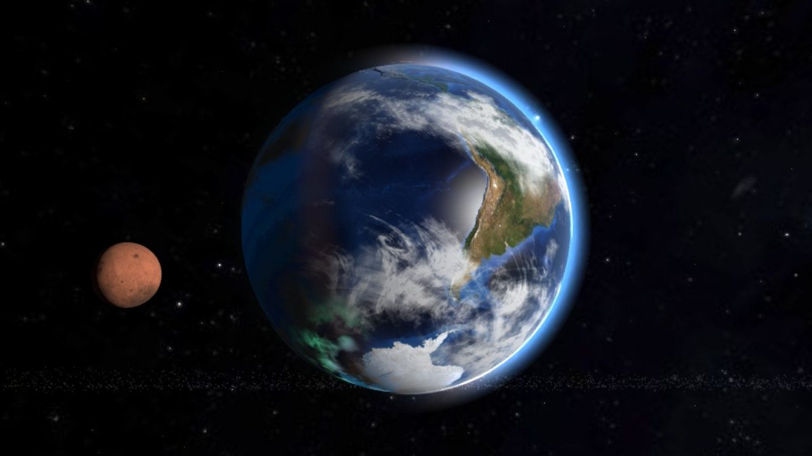
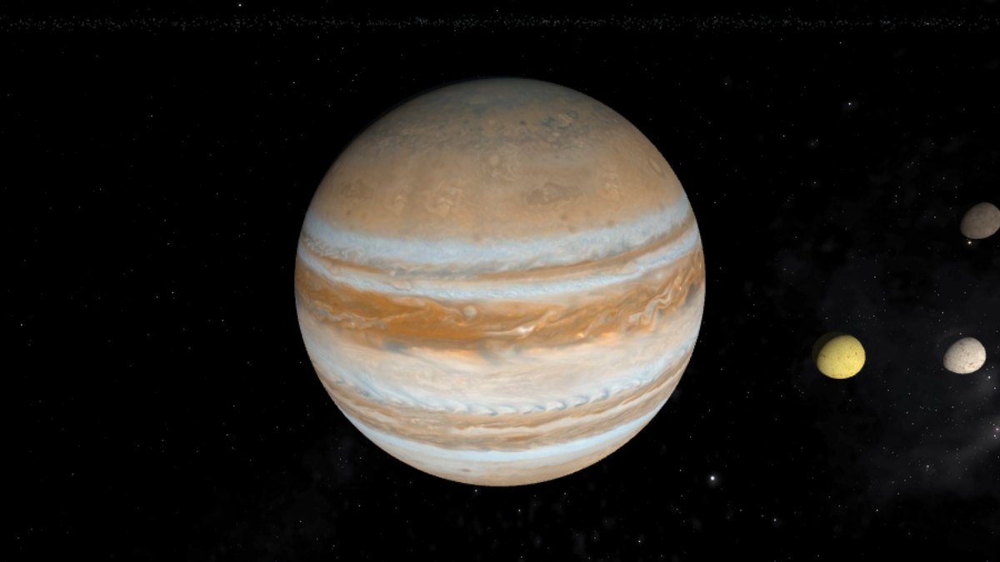
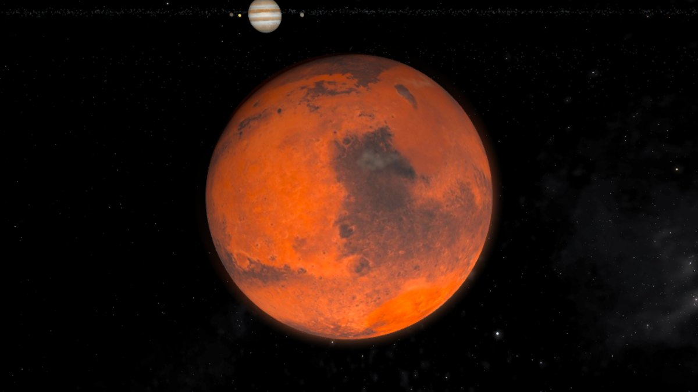
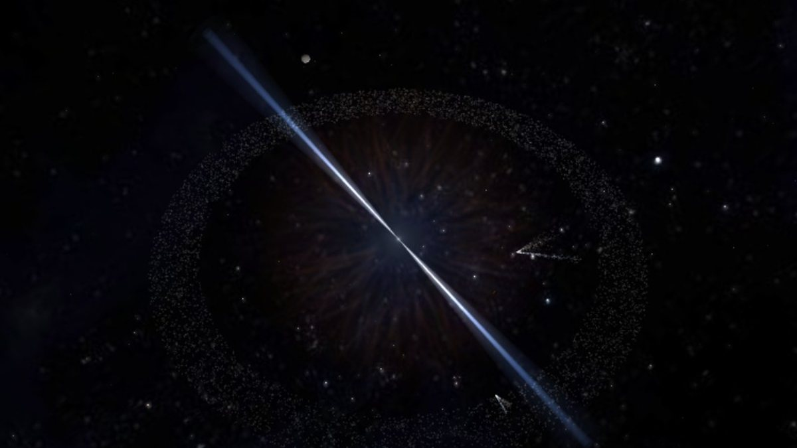
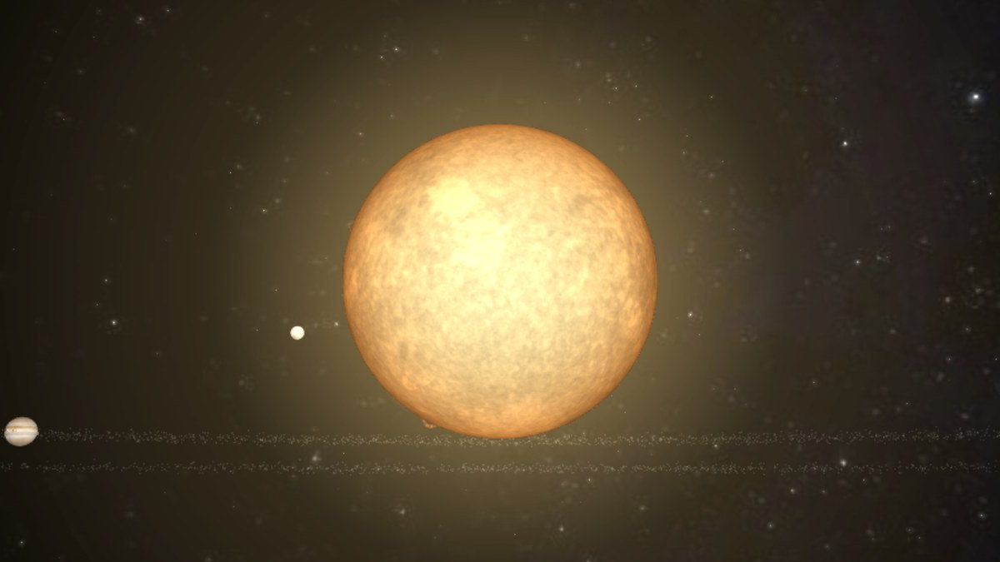
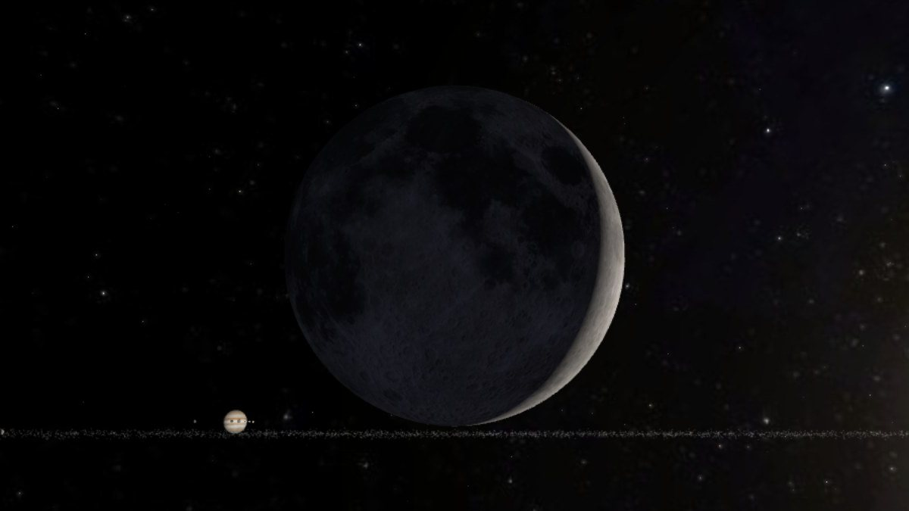
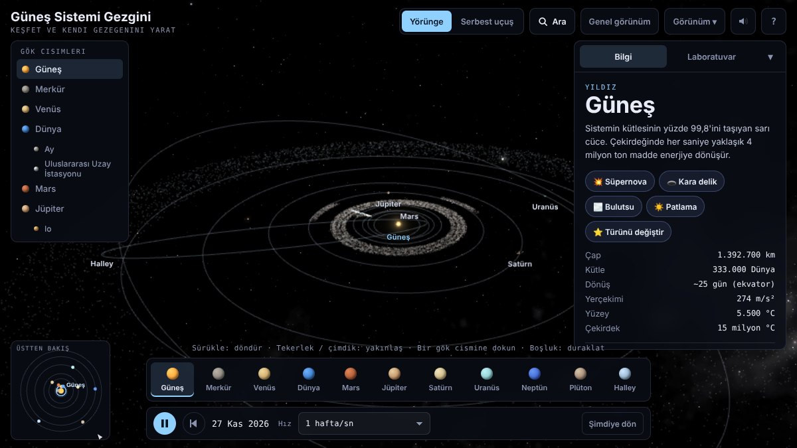

<div align="center">

# 🌌 Celestia

### Tarayıcıda çalışan, gerçek verilerle hesaplanan bir Güneş Sistemi.<br>Keşfet, boz, yeniden kur.

<br>



<sub><i>Güneş'i kara deliğe çevirdik. Diskin bize doğru dönen tarafı Doppler etkisiyle daha parlak; ışık olay ufkunun çevresinde bükülüyor.</i></sub>

<br><br>


</div>

---

## ✨ Neden farklı?

Çoğu Güneş Sistemi uygulaması bir animasyondur. **Celestia bir simülasyondur.** Gezegenler bugünkü gerçek yerlerinde durur, tutulmalar gerçek tarihlerinde olur. Laboratuvar modunda fiziği değiştirirsen sonuçlarını da görürsün. Dünya'yı Güneş'e yaklaştırırsan okyanusları kaynar. Mars'ı Dünya'ya fırlatırsan çarpışma enkazı yörüngeye savrulur. Güneş'i kara deliğe çevirirsen gezegenler donar.

<table>
<tr>
<td width="50%"></td>
<td width="50%"></td>
</tr>
<tr>
<td align="center"><b>Dünya:</b> rüzgârla sürüklenen gerçek bulut haritası, gece tarafında şehir ışıkları</td>
<td align="center"><b>Jüpiter:</b> bantlar ve Büyük Kırmızı Leke (NASA verisine dayanan doku)</td>
</tr>
<tr>
<td></td>
<td></td>
</tr>
<tr>
<td align="center"><b>Mars:</b> Olympus Mons, Valles Marineris, mevsimsel toz fırtınaları</td>
<td align="center"><b>Pulsar:</b> süpernova kalıntısı bulutsu ve deniz feneri gibi dönen ışınlar</td>
</tr>
<tr>
<td></td>
<td></td>
</tr>
<tr>
<td align="center"><b>Güneş:</b> granülasyon, güneş lekeleri, H-alfa filtresi, koronal kütle atımları</td>
<td align="center"><b>Ay:</b> NASA verisinden kraterler ve gerçek evreler</td>
</tr>
</table>

---

## 🔭 Gerçek verilerle hesaplananlar

| | |
|---|---|
| 🪐 **Konumlar** | Gezegenler ve Ay [astronomy-engine](https://github.com/cosinekitty/astronomy) ile hesaplanır. Ekrandaki yerleri bugünkü gerçek yerleridir. |
| 🌑 **Tutulmalar** | Bir sonraki güneş veya ay tutulmasına tek dokunuşla gidilir. Ay'ın gölgesi Dünya'ya düşer, tutulan Ay kızıla döner. |
| 🌍 **Dokular** | NASA görev verilerine (Blue Marble, MESSENGER, Magellan, Cassini, Voyager, LRO gibi) dayanan, Solar System Scope'un hazırladığı dokular. Bazıları, özellikle dış gezegenlerinki, sanatsal yorumdur; ham fotoğraf değildir. |
| ✴️ **Gökyüzü** | 5.000+ parlak yıldız (Hipparcos / Yale), takımyıldızlar ve doğru yere yerleştirilmiş Samanyolu panoraması. Andromeda ve Macellan Bulutları da gerçek yerlerinde. |
| 🛰️ **Uzay araçları** | ISS, James Webb, Voyager 1, New Horizons ve Parker Solar Probe. Derin uzay araçları güzergâh noktaları arasında yaklaşık hesaplanır. ISS'in yörüngesi şematiktir (51,6° eğimli, 92,7 dakikalık daire); anlık gerçek konumu gösterilmez. |
| 📏 **Ölçek** | Varsayılan görünümde mesafeler ve boyutlar okunabilsin diye sıkıştırılmıştır. Gerçek oranlar için Görünüm menüsünden "Gerçek ölçek"i seç. |
| ☄️ **Küçük cisimler** | Halley ve 67P/Çuryumov–Gerasimenko kuyruklu yıldızları kendi yörüngelerinde gezer; günberiye yaklaşınca iyon ve toz kuyruğu çıkar, günötede kuyruk kaybolur. Apophis ve Bennu asteroitleri, asteroit kuşakları ve Plüton da var. Apophis'in 13 Nisan 2029'da Dünya'ya yaklaşan geçişi takvimde işaretlidir. Meteor yağmurları (Perseidler gibi) kaynak cisimleriyle bağlantılı gösterilir. |
| ⭐ **Diğer yıldızlar** | Proxima Centauri, Alfa Centauri, TRAPPIST-1 ve yedi gezegeni, 55 Cancri'nin lav dünyası, iki güneşli Kepler-16. |

## 🧪 Laboratuvar: "Ya olsaydı?"

- **İklim modeli.** Yörüngeyi, boyutu ya da atmosferi değiştir; sıcaklık, buzullar, okyanuslar ve yaşanabilirlik puanı canlı olarak güncellenir.
- **Mevsimler, CO₂ ve yaşam.** Eksen eğikliği mevsim farkını belirler: 0°'de mevsim yoktur, 90°'de yaz-kış farkı Dünya'dakinin yaklaşık iki katına çıkar; Dünya'da hava durumu ve şehir sıcaklıkları da buna uyar. CO₂ düzeyi her ikiye katlanmada yaklaşık 3 °C ısıtır. Levha tektoniği açıksa karbonat-silikat döngüsü CO₂'yi dengeler (zaman ölçeği izlenebilsin diye sıkıştırılmıştır); kapalıysa denge kurulmaz. Gün uzunluğu, mevsim uçları ve tektonik yaşanabilirlik puanına girer. Dünya için basitleştirilmiş Milankovitch döngüleri (eğiklik, yörünge basıklığı, günberi yönü) "1000 yıl/sn" hızında buzul çağı benzeri dalgalanma verir. Bunlar eğitici modellerdir, bilimsel tahmin değildir.
- **Hazır deneyler.** Arama kutusunu aç (`/`): "Ay nasıl oluştu?", "Kontrolden çıkan sera etkisi", "Dünya, Mars'ın yerinde olsaydı" ve "Ay çok yaklaşırsa" tek tıkla kurulur, ilgili cisme odaklanır ve sonucu izlemen için grafiği açar.
- **Canlı grafik.** Bilgi panelindeki "Grafik" satırı seçili cismin Güneş'e uzaklığını, hızını, yüzey sıcaklığını ve yaşanabilirlik puanını simülasyon zamanına göre çizer; en az ve en çok değerleri yazar. Bir ayarı değiştirince sonucun nasıl geliştiğini eğriden izleyebilirsin.
- **Kütleçekim simülasyonu.** Gezegenler birbirini çeker. İki gezegeni çarpıştırabilirsin; Roche sınırını aşan uydular parçalanır.
- **Yıldızın ölümü.** Güneş'i kırmızı deve, beyaz cüceye, süpernovaya ya da kara deliğe dönüştürebilirsin. Kara deliğe fazla yaklaşan gezegen spagetti gibi uzayıp parçalanarak yutulur.
- **Yıldız fırlat.** Eklediğin yıldızı Güneş'e, bir gezegene ya da kara deliğe fırlat; kompakt çiftler kütleçekim dalgasıyla sarmalanıp birleşir, normal yıldızlar ortak zarf gazıyla iç içe geçer.
- **Işığı büken kara delik.** Kara deliğe yaklaşınca her piksel için ışığın yolu Schwarzschild uzay-zamanında hesaplanır. Diskin arka tarafı gölgenin üstüne ve altına sarılır, arkadaki gezegenler ve yıldızlar uzaklıklarına göre bükülür, Einstein halkası oluşur.
- **Zamanı geri sar.** Çarpışmaları ve felaketleri geri alabilirsin; ileri oynatınca aynen yeniden yaşanırlar.
- **Kendi gezegenini yarat.** Ekle kataloğundan gezegen, yıldız, nötron yıldızı ya da kara delik seç; yalnızca o cismin ayarları çıkar. Sistemi bir kodla arkadaşına gönderebilirsin.
- **Gerçek ölçek.** Üstteki Görünüm menüsündeki mesafe ayarında "Gerçek ölçek"i seç: boyutlar ve uzaklıklar gerçek oranlarında olur. Gezegenlerin çoğu pikselden küçüktür; yerlerini küçük bir nokta gösterir, yaklaşınca gerçek küre görünür.
  - Gerçek ölçekte doğru olanlar: Güneş, gezegenler ve uyduların yarıçapları; gezegenlerin Güneş'e, uyduların gezegenlerine uzaklığı (Ay'ın uzaklığı ay içinde yerberi ile yeröte arasında, ~357–406 bin km, değişir); kırmızı dev (~200 Güneş yarıçapı: Merkür ve Venüs'ü yutar), beyaz cüce (~6.000 km yarıçap), nötron yıldızları (10 km yarıçap) ve kara delikler (olay ufku 2,95 km × Güneş kütlesi, gölge bunun 2,6 katı). Nötron yıldızı ve kara delik bu ölçekte çoğu zaman bir işaret noktasıdır; küreyi, diski ve ışık bükülmesini görmek için cisme odaklanıp iyice yaklaşmak gerekir. Yutulma ve çarpışma mesafeleri de gerçek boyuta göre hesaplanır.
  - İstisnalar (görünsün diye büyütülmüş çizilir, bilgi panelinde "Ekranda" satırı kaç kat olduğunu yazar): kuyruklu yıldız çekirdekleri, asteroitler ve uzay araçları. Diğer ölçeklerde beyaz cüce, nötron yıldızı ve kara delik de büyütülmüş, kırmızı dev küçültülmüş çizilir; Ay'ın uzaklığı sabittir.
- **Gelgit kilidi, yüzey görünümü, ölçek yolculuğu.** Bir gezegenin yüzeyinden gökyüzüne bakabilir ya da Güneş'ten en yakın yıldızlara kadar uçabilirsin.

## 🎧 Ekstralar

Bunların hepsi isteğe bağlı:
- NASA ses dönüştürmelerinden esinlenen gezegen sesleri. Pulsar saniyede 10 atımla tıkırdar.
- Gerçek fırtına mevsimlerine göre oluşan kasırgalar.
- Kutup ışıkları.
- Güneş rüzgârı parçacıkları.
- **Ara** düğmesi: gök cisimlerini ve eylemleri ("Güneş'i kara deliğe dönüştür", "Sonraki Ay tutulması" gibi) yazarak bul.
- Telefona uygun arayüz.

<div align="center">

</div>

---

## 🚀 Çalıştır

```bash
git clone https://github.com/emirhnnd/Celestia.git
cd Celestia
python3 -m http.server 8000
```

Sonra tarayıcıda **http://localhost:8000** adresini aç. Derleme yok, `npm install` yok. Dosya düzeni:

| Yer | İçerik |
|---|---|
| `index.html` | Sayfa iskeleti (arayüzün HTML'i) |
| `css/style.css` | Stiller |
| `js/` | Uygulama kodu, konuya göre 15 dosya (`01-temel.js` … `15-baslat.js`) |
| `data/` | Gömülü veriler: yıldız kataloğu, Dünya kara maskesi |
| `tex/` | Dokular |

`js/` altındaki dosyalar `index.html`'deki sırayla yüklenir ve aynı kapsamı paylaşır: bir dosyada tanımlanan ad sonrakilerde de geçerlidir. Yeni kod eklerken iki kural var: yüklenirken çalışan kod yalnızca kendinden önceki dosyalardaki adlara dokunabilir; yükleme sırasında ertelenecek iş `setTimeout` yerine `afterLoad(...)` ile sıraya konur.

> three.js ve astronomy-engine CDN'den, Onest yazı tipi Google Fonts'tan yüklenir; bu yüzden ilk açılışta internet bağlantısı gerekir. Kütüphaneler ya da WebGL yüklenemezse uygulama boş ekran yerine bir hata ekranı gösterir.

> Dosyayı doğrudan çift tıklayıp `file://` ile açarsan tarayıcı güvenliği dokuların yüklenmesini engeller. Uygulama yine çalışır, ama kodla üretilen yedek dokulara geçer.

**GitHub Pages ile yayınlamak için:** Settings → Pages → *Deploy from a branch* → `main` / `(root)`. Ek bir iş akışı (workflow) gerekmez.

## 🌿 Dallar

| Dal | İçerik |
|---|---|
| `main` | NASA verisine dayanan gerçek dokular |
| `eski-modeller` | Kodla üretilen (prosedürel) gezegen dokuları. Daha hafiftir; Dünya dışındaki gezegenlerde gerçek doku kullanmaz. |

Geliştirme sırasında açılan diğer dallar (`gercek-olcek`, `laboratuvar-karadelik` gibi) geçmiş için saklanıyor.

## 🧪 Test

`test/` klasöründe, uygulamayı başsız bir tarayıcıda açıp birleşmeleri, çarpışmaları, geri sarmayı, sıfırlamayı, paylaşma kodunu, meteor yağmurunu, fırtına takibini ve iklim modelini (eğiklik, CO₂, tektonik termostat) gerçek zamanlı deneyen senaryolar var. Değişiklikten sonra çalıştır:

```bash
cd test
npm install
npm test
```

`npm test` senaryoları dört mesafe seçeneğinde (Kompakt, Geniş, Gerçekçiye yakın, Gerçek ölçek) sırayla çalıştırır, ardından savunma testlerini çalıştırır. Windows, macOS ve Linux'ta aynı komut çalışır. Her senaryo beklenen sonuçla karşılaştırılır ve `GEÇTİ` ya da `KALDI` yazar; bir senaryo beklenen sonuç çıkmazsa, sayfada hata oluşursa ya da kare döngüsünde hata yakalanırsa kalır. En sonda özet yazılır; her şey geçtiyse çıkış kodu 0'dır. Ekran görüntüleri `test/shots/` klasörüne kaydedilir. Playwright'ın indirdiği tarayıcı yerine kendi Chromium'unu kullanmak için `CHROMIUM` ortam değişkenine tarayıcının yolunu ver.

| Komut | Ne çalıştırır |
|---|---|
| `npm test` | Dört ölçekte senaryolar + savunma testleri (uzun sürer) |
| `node tum.js 2.5` | Yalnızca bir ölçek: `1`, `2.5`, `6` ya da `R` |
| `node tum.js savunma` | Yalnızca savunma testleri |

Tek bir senaryoyu denemek için `ONLY` ortam değişkenine adını ver (virgülle birden fazla yazılabilir); PowerShell'de `$env:ONLY='enkaz'; node tum.js 1`.

Savunma testleri sayfa kabuğunu (doctype, meta etiketleri), paylaşma kodunun güvenliğini (`__proto__` gibi sahte anahtarlar), ölçek değişince durumun korunmasını, three.js ya da WebGL yokken hata ekranını ve kuyruklu yıldız kuyruklarını denetler. Ayrıca telefon ekranını (390×844, taşma, dokunma alanları, grafik), bir alt sistem hata verdiğinde simülasyonun sürmesini, bozuk kayıtla ya da eksik veri dosyasıyla açılışı ve cisim ekleyip silince grafik belleğinin sızmamasını sınar.

## 🛠️ İçinde neler var

- **three.js r128:** 3D sahne
- **astronomy-engine 2.1.19:** gök mekaniği hesapları
- **Elle yazılmış GLSL gölgelendiriciler:** Güneş granülasyonu, hareketli bulutlar ve kasırgalar, lav, analitik kraterler, halka ve tutulma gölgeleri, ışın izlemeli kara delik (kütleçekimsel mercek, Doppler ve kütleçekimsel kırmızıya kayma)
- **Leapfrog integratörü:** gezegenler arası kütleçekim ve çarpışma fiziği
- **Onest:** arayüz yazı tipi (Google Fonts)

## 📜 Kaynaklar ve lisanslar

- Kod: [MIT](LICENSE). Dokular bu lisansın dışındadır, aşağıdaki kaynaklarının lisansına tabidir.
- Gezegen, Güneş, Ay, halka, bulut ve Samanyolu dokuları: [Solar System Scope](https://www.solarsystemscope.com/textures/), CC BY 4.0 (NASA verilerine dayanır)
- Dünya gündüz ve gece dokuları: NASA Blue Marble ve Black Marble
- Yıldızlar ve takımyıldızlar: [d3-celestial](https://github.com/ofrohn/d3-celestial) © Olaf Frohn, BSD (Hipparcos / Yale Parlak Yıldız Kataloğu)
- Kıyı çizgileri: Natural Earth (kamu malı)

<div align="center">
<br>
<sub>Merakla yapıldı. Bir yıldız bırakmayı unutma ⭐</sub>
</div>
